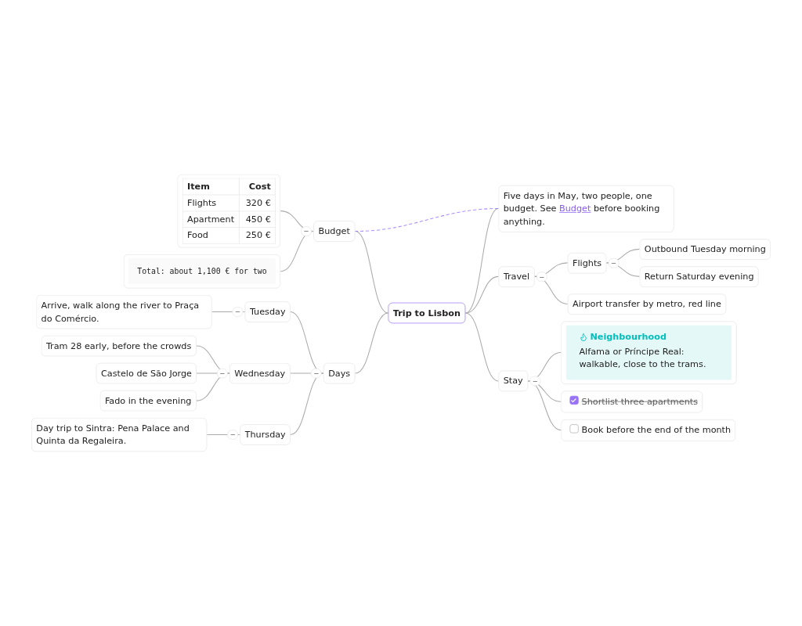
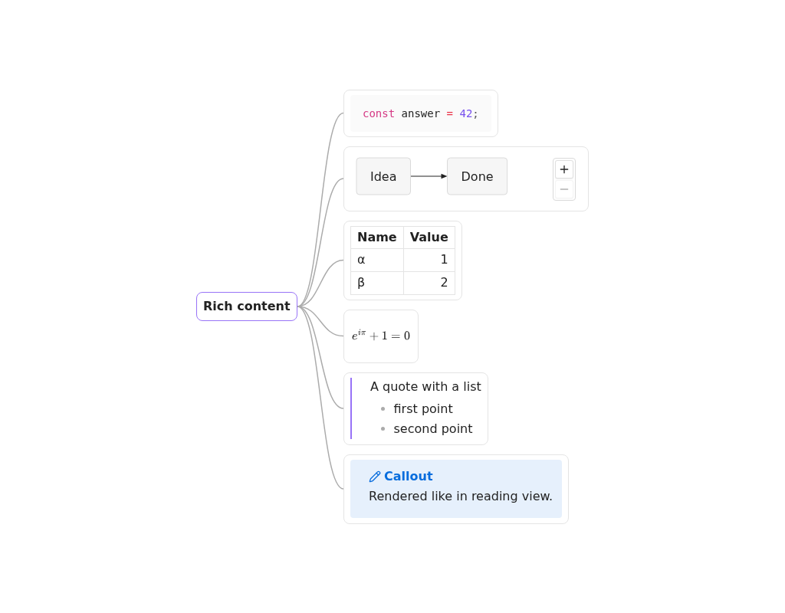

# Mind Mapper

Show any Markdown note as a live mind map in Obsidian. Headings, paragraphs, lists and blocks become nodes, rendered the way reading view renders them, and the map follows the note while you write.

## Features

- **Live companion:** open the map next to the note; edits show up in the map after Obsidian saves the note (about 2 s), and pan, zoom, selection and collapsed branches are kept
- **Real content:** code with highlighting, tables, math, callouts, Mermaid diagrams, task checkboxes (read-only) and image thumbnails, rendered by Obsidian itself
- **XMind-like layouts:** a balanced circle layout by default, plus left-to-right, right-to-left, top-to-bottom and bottom-to-top; per note via frontmatter
- **Navigation:** double click a node to jump to its line, links open like in Obsidian with page preview, links to headings and blocks in the same note are drawn as dashed lines
- **Collapse, full screen, back to root,** and smooth panning on notes with thousands of nodes

## How a note becomes a map

- The root is the note's single H1 (if nothing comes before it), else the file name; `mind_map_title` overrides it
- Every heading is a branch, nested by level (skipped levels attach to the nearest heading above)
- Every paragraph, list item and block (code, table, math, quote, callout) is a node under its heading; nested list items nest their nodes
- Frontmatter, comments (`%% %%`), horizontal rules, HTML blocks and footnote definitions are left out
- Large nodes are capped at the max node size (default 320 × 240 px) with a fade; the expand icon shows all of it
- Image embeds show a thumbnail; other embeds become plain links (no transclusion)

## Opening a map

- Command palette: "Open as mind map" (while a Markdown note is active)
- File menu of a note: "Open as mind map"
- Ribbon icon "Open as mind map": opens the active note

The map opens in a split next to the note and stays pinned to that note (also after a rename).

## Commands

No command has a default hotkey (Obsidian plugin guidelines); assign your own in Settings > Hotkeys. Avoid `Ctrl/Cmd + =`, `Ctrl/Cmd + -` and `Ctrl/Cmd + 0`: Obsidian uses them to zoom the whole app.

| Command | Available | Suggested hotkey |
|---|---|---|
| Open as mind map | a Markdown note is active | |
| Zoom in | a mind map is active | `Ctrl/Cmd + Shift + =` |
| Zoom out | a mind map is active | `Ctrl/Cmd + Shift + -` |
| Fit to view | a mind map is active | `Shift + 1` |
| Reset zoom to 100% | a mind map is active | `Shift + 0` |
| Collapse all | a mind map is active | `Ctrl/Cmd + Shift + [` |
| Expand all | a mind map is active | `Ctrl/Cmd + Shift + ]` |
| Back to root | a mind map is active | `Shift + H` |
| Toggle full screen | a mind map is active | `Ctrl/Cmd + Shift + F11` |

## Map navigation

- Mouse wheel / two-finger scroll: pan
- `Ctrl/Cmd` + wheel, trackpad pinch: zoom at the pointer
- Drag on empty canvas: pan
- Floating controls (bottom center): zoom out, current zoom (click resets to 100%), zoom in, fit to view, collapse all, expand all, back to root, full screen
- Click a node: select it; click the empty canvas: clear the selection
- Double click a node: jump to its line in the note (in the note's tab, else a split next to the map)
- Round button on a node's edge: collapse / expand its branch (shows the number of hidden nodes when collapsed)
- Links inside nodes behave like in Obsidian: click opens (`Ctrl/Cmd` + click: new tab), hover shows the page preview
- Links to a heading or block in the same note (`[[#Heading]]`, `[[#A#B]]`, `[[#^id]]`, `[[This note#Heading]]`) are drawn as dashed lines between the nodes; a collapsed end attaches to its nearest visible ancestor
- Full screen covers the whole Obsidian window (previews, menus and notices stay on top); `Esc` or the button top right exits and restores the previous view; the controls fade after 2 s without mouse movement

## Layouts

| Layout | Shape |
|---|---|
| `circle-clockwise` (default) | Balanced like XMind: the first half of the first-level branches on the right (top to bottom), the rest on the left (bottom to top) |
| `circle-counter-clockwise` | The same, mirrored |
| `left-to-right`, `right-to-left`, `top-to-bottom`, `bottom-to-top` | All branches grow in that direction |

## Frontmatter

| Key | Values | Default |
|---|---|---|
| `mind_map_title` | any text | the single H1, else the file name |
| `mind_map_layout` | one of the layouts above | the plugin setting |

An unknown layout or a title that is not text falls back to the default and shows a notice once per note and value (per session).

## Settings

| Setting | Range | Default |
|---|---|---|
| Default layout | the layouts above | `circle-clockwise` |
| Max node width | 160–800 px | 320 px |
| Max node height | 120–800 px | 240 px |
| Sibling gap | 0–200 px | 12 px |
| Level gap | 20–400 px | 60 px |

Content larger than the max node size is clipped with a fade; the expand icon shows all of it. Changes apply to open maps right away.

## Large notes

- Only nodes in and around the visible area are rendered; panning renders the rest as they come into view (at most 40 new nodes per frame, nearest first)
- Below 20 % zoom, maps with more than 60 nodes in view are drawn as outlines without text, and more than 300 nodes in view are outlines at any zoom; zoom in to read
- Edges and link lines are always complete
- Benchmark (`npm run perf:e2e`, headless): 1,000 nodes open in about 0.1 s and pan and zoom at 60 fps; 5,000 nodes open in about 0.25 s

## Known limits

- Desktop only
- The map is read-only: edit the note, not the map (checkboxes in nodes cannot be ticked)
- Embedded notes, PDFs and media are shown as links, not transcluded
- Dashed link lines only connect headings and blocks within the same note; lines are not routed around nodes
- The map updates when Obsidian saves the note (about 2 s after typing stops), not on every keystroke
- Collapsed branches are remembered while the map is open, not across restarts

## Installation

- From the community directory: once published, search for "Mind Mapper" in Settings > Community plugins
- Manually: download `main.js`, `manifest.json` and `styles.css` from a release into `<vault>/.obsidian/plugins/mind-mapper/`, then enable Mind Mapper in Settings > Community plugins
- Requires Obsidian 1.7.4 or later (desktop)

## Development

- Requirements: Node.js and npm (the devcontainer has both)
- `npm install`
- Vaults
  - `test-vault/`: versioned test notes (source, tracked in git)
  - `dev-vault/` in the main checkout: the one vault you open in Obsidian, ignored by git, shared by all worktrees
- `npm run dev` (from the main checkout or any worktree): watch build into `dev-vault/.obsidian/plugins/mind-mapper/` (also copies `manifest.json`, `styles.css`, writes `.hotreload`)
  - On start it copies the current checkout's `test-vault/` notes into `dev-vault/` and enables Mind Mapper there; notes of the same name are overwritten (edit test notes in `test-vault/`, not in `dev-vault/`), nothing is deleted, recordings (`*.cache.json`) are never overwritten
  - `MIND_MAPPER_PLUGIN_DIR=<vault>/.obsidian/plugins/mind-mapper npm run dev` targets another vault instead (plugin files only, no notes copied)
- One-time setup on the host: open `dev-vault/` of the main checkout as a vault in Obsidian, turn on community plugins; optionally install [Hot Reload](https://github.com/pjeby/hot-reload) into it
- README images: `npm run readme:images` (headless, writes `docs/images/`)
- E2E against another Obsidian version: `OBSIDIAN_VERSION=1.7.4 OBSIDIAN_INSTALLER=earliest npm run test:e2e` (default 1.15.0; 1.7.4 is the `minAppVersion`)
- Parser fixtures: notes in `test-vault/fixtures/`, recordings of Obsidian's metadata cache next to them (`*.cache.json`)
  - Headless (preferred): `npm run fixtures:record` records all of them in real Obsidian; commit them
  - Manual: in Obsidian run "Record parser fixtures (dev)", then `npm run fixtures:pull`
- `npm run check`: format check, lint, typecheck, unit tests, production build
- `npm test` / `npm run test:watch`: unit tests (Vitest, `obsidian` is mocked in `tests/mocks/obsidian.ts`)
- `npm run test:e2e`: end-to-end tests in real, headless Obsidian (`e2e/specs/`)
  - Uses [wdio-obsidian-service](https://github.com/jesse-r-s-hines/wdio-obsidian-service), which downloads Obsidian into `.obsidian-cache/` and opens a temp copy of `test-vault/`
  - Needs Xvfb and Electron libraries: `scripts/install-e2e-deps.sh` (run automatically when the devcontainer is created)
- `npm run perf:e2e`: performance spike on generated 1,000 and 5,000 node notes in headless Obsidian
  - Prints time to first layout, time until the layout settles, re-layout count and the longest frame while panning; writes `e2e/perf/last-run.json`
  - No timing assertions; compare against `e2e/perf/baseline.json` by hand
- Merge gate: `npm run check` and `npm run test:e2e` pass

## Release (local)

- `npm version <x.y.z>` (or `patch|minor|major`): bumps `package.json`, syncs `manifest.json` and `versions.json`, commits `chore: release <x.y.z>` and tags `<x.y.z>` (no `v` prefix: Obsidian needs the tag to equal the manifest version)
- `npm run release`: runs `npm run check`, then copies `main.js`, `manifest.json`, `styles.css` into `release/<x.y.z>/` (the GitHub release assets for that tag) and writes `release/mind-mapper-<x.y.z>.zip` when `zip` is installed
- Community submission: the manifest follows the directory rules (checked in `tests/manifest.test.ts`); the id `mind-mapper` and the name "Mind Mapper" were not taken on 2026-11-08
