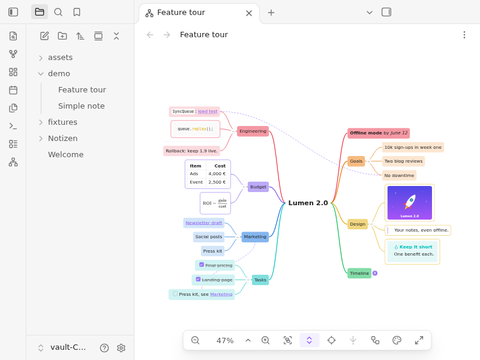

# Mind Mapper

Show any Markdown note as a live mind map in Obsidian. Headings, paragraphs, lists and blocks become nodes, rendered the way reading view renders them, and the map follows the note while you write.

Full guide: [docs/user-manual.md](docs/user-manual.md)

## Features

- **Live companion:** open the map next to the note; edits show up in the map after Obsidian saves the note (about 2 s), and pan, zoom, selection and collapsed branches are kept
- **Real content:** code with highlighting, tables, math, callouts, Mermaid diagrams, task checkboxes (read-only) and image thumbnails, rendered by Obsidian itself; nested tags as two-part pills (`#project/alpha` | `backend`)
- **Layouts:** a balanced circle layout by default, plus left-to-right, right-to-left, top-to-bottom, bottom-to-top and a kanban board (columns with cards and their counts); per note via frontmatter, or for the open map from the control bar
- **Colour themes:** every main branch in its own colour (`rainbow` by default, `ocean`, `forest`, your `accent` colour or plain grey), with filled first-level nodes and a large root; per note or as default, or for the open map from the control bar; follows light and dark mode
- **Navigation:** double click a node to jump to its line, links open like in Obsidian with page preview, tags open the tag search, links to headings and blocks in the same note are drawn as dashed lines
- **Drill down:** show one branch as a map of its own, with the branch as the centre; step back out one level at a time
- **Collapse, full screen, back to root,** and smooth panning on notes with thousands of nodes
- **Languages:** English and German; follows Obsidian's language setting (Settings → General → Language)

## How a note becomes a map

- The root is the note's single H1 (if nothing comes before it), else the file name; `mind-mapper-title` overrides it
- Every heading is a branch, nested by level (skipped levels attach to the nearest heading above)
- Every paragraph, list item and block (code, table, math, quote, callout) is a node under its heading; nested list items nest their nodes
- Frontmatter, comments (`%% %%`), HTML blocks and footnote definitions are left out
- Horizontal rules (`---`, `***`, `___`) are not nodes: they show as a dashed line in a wider gap between the two branches they separate, also before a heading (e.g. `---` between two `##` sections); one before the first or after the last node of a section is not shown
- Large nodes are capped at the max node size (default 320 × 240 px) with a fade; the expand icon shows all of it
- Image embeds show a thumbnail; other embeds become plain links (no transclusion)

## Opening a map

- Command palette: "Open as mind map" (while a Markdown note is active)
- File menu of a note: "Open as mind map"
- Ribbon icon "Open as mind map": opens the active note

The map opens in a split next to the note and stays pinned to that note (also after a rename).

## Commands

No command has a default hotkey (Obsidian plugin guidelines); assign your own in Settings > Hotkeys. Avoid `Ctrl/Cmd + =`, `Ctrl/Cmd + -` and `Ctrl/Cmd + 0`: Obsidian uses them to zoom the whole app.

| Command | Available | Suggested hotkey |
|---|---|---|
| Open as mind map | a Markdown note is active | |
| Zoom in | a mind map is active | `Ctrl/Cmd + Shift + =` |
| Zoom out | a mind map is active | `Ctrl/Cmd + Shift + -` |
| Fit to view | a mind map is active | `Shift + 1` |
| Reset zoom to 100% | a mind map is active | `Shift + 0` |
| Collapse all | a mind map is active | `Ctrl/Cmd + Shift + [` |
| Expand all | a mind map is active | `Ctrl/Cmd + Shift + ]` |
| Back to root | a mind map is active | `Shift + H` |
| Toggle full screen | a mind map is active | `Ctrl/Cmd + Shift + F11` |
| Change layout… | a mind map is active | |
| Next layout | a mind map is active | `Shift + L` |
| Change color theme… | a mind map is active | |
| Next color theme | a mind map is active | `Shift + T` |
| Drill down into selection | a node with children is selected | |
| Drill out one level | the map is drilled in | |
| Show the whole map | the map is drilled in | |

"Change layout…" and "Change color theme…" open the menu of the control bar button; arrow keys and Enter choose without the mouse. "Next layout" and "Next color theme" step to the next one (after the last, the first again), handy while presenting.

The key `D` drills in and out without a hotkey (see [Drill down](#drill-down)); it only works while the map has focus, so typing a "d" in a note is not affected.

## Map navigation

- Mouse wheel / two-finger scroll: pan
- `Ctrl/Cmd` + wheel, trackpad pinch: zoom at the pointer
- Drag on empty canvas: pan
- Double click the empty canvas: fit the whole map into view (also in full screen)
- Fit to view enlarges small maps (e.g. after Collapse all) up to the setting "Max zoom for fit" (default 150%); large maps shrink to fit; a margin keeps nodes and collapse badges off the edges
- Zoom in / out snap to steps: 10, 25, 50, 75, 100, 125, 150, 200, 300, 400%
- Fit to view, the zoom controls, back to root and layout changes glide smoothly (a layout change cross-fades first); wheel and trackpad stay immediate; with the system setting "reduce motion" everything jumps at once
- Floating controls (bottom center): zoom out, zoom level (type a zoom such as `129` and press Enter; the chevron next to it offers 50–200% and Fit to view), zoom in, fit to view (two boxes in a frame), collapse all / expand all (one button: highlighted while anything is collapsed, then it expands all), back to root, drill down (arrow down to a dot), layout, color theme, full screen
- Click a node: select it; click the empty canvas: clear the selection
- Double click a node: jump to its line in the note (in the note's tab, else a split next to the map)
- Round button on a node's edge: collapse / expand its branch (shows the number of hidden nodes when collapsed)
- Links inside nodes behave like in Obsidian: click opens (`Ctrl/Cmd` + click or middle click: new tab), `Ctrl/Cmd` + hover shows the page preview (like in other plugin views; Obsidian's core plugin "Page preview" in Settings → Core plugins lets you change the modifier)
- Click a tag inside a node (also either part of a nested tag): opens the search with that tag (`tag:#project/alpha/backend`), like in reading view; needs Obsidian's core plugin "Search"
- Links to a heading or block in the same note (`[[#Heading]]`, `[[#A#B]]`, `[[#^id]]`, `[[This note#Heading]]`) are drawn as dashed lines between the nodes; a collapsed end attaches to its nearest visible ancestor
- Click a dashed link line: highlight the connection (both end nodes ringed, the dashed line thicker and drawn above the nodes); click the empty canvas, a node or another line to end it; selecting a node never highlights its links
- Double click a dashed link line: jump to the line in the note where the link is written
- Full screen covers the whole Obsidian window (previews, menus and notices stay on top); `Esc` or the button top right exits and restores the previous view; the controls fade after 2 s without mouse movement

## Drill down

Focus on one branch: the selected node becomes the centre of the map, and only it and everything below it are shown.

- Select a node with children, then the drill down button in the control bar (arrow down to a dot) or the key `D` (while the map has focus): the node becomes the centre, large and without a box like the root; its children become the first level with their own branch colours; the map is fitted
- Inside a drilled view, select another node and drill again (e.g. Project → Tasks → Phase 2)
- The button or `D` with nothing to drill into (the centre or nothing selected) goes back out one level; the command "Show the whole map" goes straight back. The node you drilled out of stays selected, and the map is fitted to view like after "Fit to view"
- While drilled in, the centre has a small target icon above it and the button is highlighted; the button is disabled when there is nothing to drill into or out of
- Link lines to nodes outside the drilled part are hidden
- "Back to root" goes to the current centre; collapse, layout, theme, full screen and double click to jump work as usual
- The view glides towards the node, then the map cross-fades into the drilled view (drilling out runs it in reverse); with the system setting "reduce motion" it switches instantly. Pressing `D` again during the animation finishes it at once
- The drilled branch belongs to the map tab: it survives closing and reopening Obsidian; if the branch is deleted, its heading or list item text is changed, or a list item or paragraph is inserted above a drilled list item, the map quietly shows the whole note again. The note file is never written

## Layout and theme of the open map

The layout button (boxes joined by a line) and the color theme button (palette) in the control bar, also in full screen, change only the map on screen, never the note:

- The menu lists the seven layouts (balanced clockwise, balanced counter-clockwise, left → right, right → left, top → bottom, bottom → top, kanban) or the five themes; the shown one is checked
- A layout change cross-fades into the new arrangement and glides to fit it to view; a theme change only recolours it
- "Use the note's layout" / "Use the note's theme" go back to the note's frontmatter, else the plugin setting
- While a choice is active the button is highlighted, and it wins over later frontmatter edits and setting changes
- The choice belongs to the map tab: it survives closing and reopening Obsidian and following a rename; the note file is never written

## Layouts

| Layout | Shape |
|---|---|
| `circle-clockwise` (default) | Balanced: the first half of the first-level branches on the right (top to bottom), the rest on the left (bottom to top) |
| `circle-counter-clockwise` | The same, mirrored |
| `left-to-right`, `right-to-left`, `top-to-bottom`, `bottom-to-top` | All branches grow in that direction |
| `kanban` | A board: the root as headline, first-level nodes as columns side by side with their card count, their children as cards, everything deeper as indented subtasks; no lines, no collapse buttons on nodes (Collapse all leaves the column headers) |

## Frontmatter

| Key | Values | Default |
|---|---|---|
| `mind-mapper-title` | any text | the single H1, else the file name |
| `mind-mapper-layout` | one of the layouts above | the plugin setting |
| `mind-mapper-collapsed` | `true` or `false` (a checkbox in Properties) | the plugin setting "Start collapsed" |
| `mind-mapper-theme` | `none`, `rainbow`, `ocean`, `forest`, `accent` | the plugin setting "Default theme" |

`mind-mapper-collapsed: true` opens the map like after "Collapse all": root and first level visible, and branches added by later edits stay collapsed until "Expand all". Changing the value while the map is open collapses or expands all once; other edits keep what you expanded or collapsed.

`mind-mapper-theme` gives each first-level branch its own colour, in note order, repeating after the last one; everything below takes the colour of its branch. First-level nodes are filled with it, second-level nodes lightly tinted, deeper nodes are plain text on a coloured line; code, tables, callouts and other blocks keep a thin border in the branch colour. The root is large bold text. `rainbow`: red, orange, yellow, green, cyan, blue, purple. `ocean`: blue, cyan, green, purple. `forest`: green, yellow, orange, olive. `accent`: Obsidian's accent colour for every branch. `none`: the same look in greys. The colours come from the Obsidian theme, so they suit light and dark mode.

An unknown layout or theme, a title that is not text or a `mind-mapper-collapsed` that is not `true`/`false` falls back to the default and shows a notice once per note and value (per session).

## Settings

Settings > Mind Mapper, in four groups. Every setting also appears in Obsidian's settings search.

| Group | Setting | Control | Range | Default |
|---|---|---|---|---|
| Map | Default layout | dropdown | the layouts above | Balanced clockwise |
| Map | Start collapsed | toggle | on / off | off |
| Map | Default theme | dropdown | None, Rainbow, Ocean, Forest, Accent color | Rainbow |
| Map | Max zoom for fit | slider, steps of 25% | 100–400% | 150% |
| Nodes | Max node width | slider, steps of 10 px | 160–800 px | 320 px |
| Nodes | Max node height | slider, steps of 10 px | 120–800 px | 240 px |
| Spacing | Sibling gap | slider, steps of 2 px | 0–200 px | 12 px |
| Spacing | Level gap | slider, steps of 10 px | 20–400 px | 60 px |

Each slider shows its value (e.g. "320 px") and has a "Restore default" button. Content larger than the max node size is clipped with a fade; the expand icon shows all of it. Changes apply to open maps right away; "Max zoom for fit" is used the next time a map fits.

The About group shows the plugin version and a link to the source code on GitHub.

## Large notes

- Only nodes in and around the visible area are rendered; panning renders the rest as they come into view (at most 40 new nodes per frame, nearest first)
- Below 20 % zoom, maps with more than 60 nodes in view are drawn as outlines without text, and more than 300 nodes in view are outlines at any zoom; zoom in to read
- Edges and link lines are always complete
- Benchmark (`npm run perf:e2e`, headless): 1,000 nodes open in about 0.1 s and pan and zoom at 60 fps; 5,000 nodes open in about 0.25 s

## Known limits

- Desktop only
- The map is read-only: edit the note, not the map (checkboxes in nodes cannot be ticked)
- Embedded notes, PDFs and media are shown as links, not transcluded
- Dashed link lines only connect headings and blocks within the same note; lines are not routed around nodes
- The map updates when Obsidian saves the note (about 2 s after typing stops), not on every keystroke
- Collapsed branches are remembered while the map is open, not across restarts
- Renaming the root H1 resets collapse state, selection and drill-down (node IDs start with the root text)
- A `---` directly under a line of text turns that text into a heading (Markdown rule, same as reading view); leave a blank line above a divider, or use `***`
- A second `--- ... ---` block in the middle of a note is not frontmatter: its last line becomes a heading

## Installation

Requires Obsidian 1.15.0 or later (desktop).

1. Via [BRAT](https://github.com/TfTHacker/obsidian42-brat) (current way, updates automatically):
   - Install the BRAT community plugin and enable it
   - Run the command "BRAT: Add a beta plugin for testing" and enter `KingOfKalk/obsidian-plugin-mind-mapper`
   - Enable Mind Mapper in Settings > Community plugins
2. Manually from the [latest release](https://github.com/KingOfKalk/obsidian-plugin-mind-mapper/releases/latest):
   - Download `main.js`, `manifest.json` and `styles.css`
   - Put them into `<vault>/.obsidian/plugins/mind-mapper/`
   - Enable Mind Mapper in Settings > Community plugins
3. Community directory: planned

## Development

Development: see [docs/developer.md](docs/developer.md)

## Report an issue

Bugs and ideas: [open an issue](https://github.com/KingOfKalk/obsidian-plugin-mind-mapper/issues) (please include your Obsidian and Mind Mapper versions and, if you can, the note's Markdown).

## Credits

- Built with the help of [obra/superpowers](https://github.com/obra/superpowers), skills for coding agents
