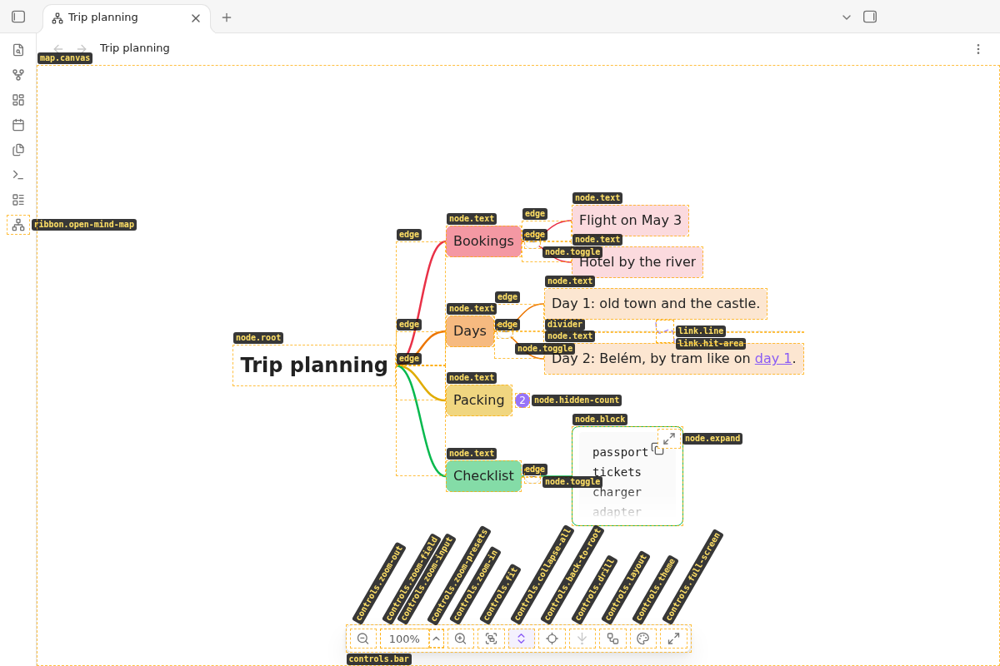
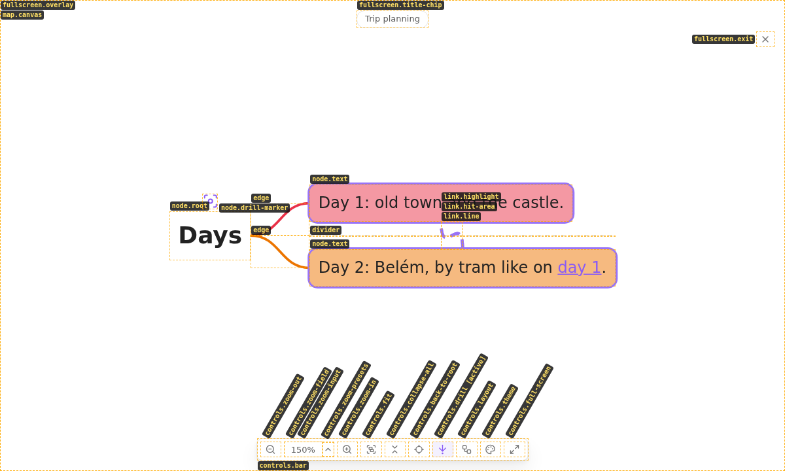
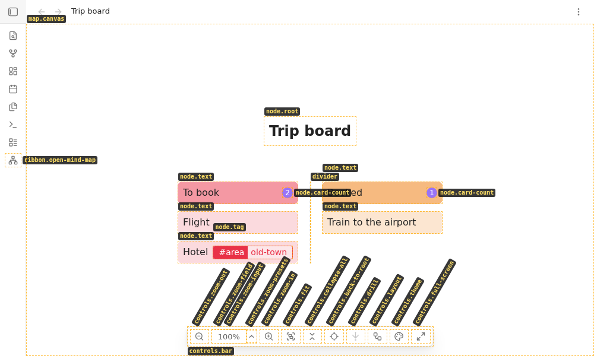

# UI elements

Stable IDs and English names for every part of Mind Mapper. Use them in issues, pull requests, reviews and tests ("`controls.fit` stays highlighted", `[data-mm-id="node.toggle"]`).

- **The ID names what an element is; its current state goes into `data-mm-state`.** An ID never changes with the state: the collapse button is `node.toggle` expanded and collapsed (`data-mm-state="expanded"` / `"collapsed"`), a highlighted control-bar button keeps its ID and gets `data-mm-state="active"`. Different kinds or separate elements get different IDs (`node.root` / `node.text` / `node.block`, `link.line` / `link.highlight`).
- States: written only through `setElementState` in `src/elementIds.ts`, allowed values per ID in `ELEMENT_STATES`, listed per element in the "States" column below. Convention: a highlighted button has `data-mm-state="active"`; when it is not highlighted the attribute is absent (never `"inactive"`). Select by state with `[data-mm-id="node.toggle"][data-mm-state="collapsed"]`.
- Styling follows `data-mm-state` too: `styles.css` highlights a collapsed `node.toggle` with `[data-mm-state="collapsed"]`, there is no state class next to it. One exception, on purpose: a highlighted control-bar button also keeps Obsidian's `is-active` class. `.clickable-icon.is-active` is Obsidian's own convention for a highlighted icon button, so Obsidian and community themes draw it in the theme's colours; `data-mm-state="active"` stays next to it for tests and this catalog. Both are set in the same place in `src/render/MapControls.ts`.
- ID format: dotted, kebab-case segments, `area.element` (`controls.zoom-presets`); the lines of the map are single words (`edge`, `divider`, `skeleton`).
- IDs are stable: renaming one is a breaking change for issues, tests and this catalog. A new element gets a new ID.
- In the DOM: every element of the plugin's own DOM carries its ID as `data-mm-id` (set through `setElementId` in `src/elementIds.ts`).
- Catalog only (no attribute): menus and menu items, the file menu item, settings rows, commands, notices, placeholder messages and frontmatter keys. Obsidian renders them; its API gives the plugin no element to tag (menu items, settings rows) or there is no element at all.
- In sync: `tests/elementIds.test.ts` (part of `npm run check`) fails when a DOM ID is missing here or no longer set in `src/`, when the states of an ID here and in `ELEMENT_STATES` differ or a listed state is not set in `src/`, and when a command, settings row, notice, placeholder message or frontmatter key and this catalog differ. Menus and the file menu item are not checked.
- Dev builds (`npm run dev`, `npm run dev:build`): the command "Show element IDs (dev)" labels every element with its ID. Release builds do not contain it.

## Reference images

Made with "Show element IDs (dev)" by `npm run ui:images` (writes `docs/images/ui-elements*.png`).

## Contents

- [Plugin entry points](#plugin-entry-points)
- [Map view](#map-view)
- [Nodes](#nodes)
- [Lines](#lines)
- [Control bar](#control-bar)
- [Menus](#menus)
- [Full screen](#full-screen)
- [Content overlay](#content-overlay)
- [Placeholder messages](#placeholder-messages)
- [Notices](#notices)
- [Commands](#commands)
- [Settings](#settings)
- [Frontmatter keys](#frontmatter-keys)

## Plugin entry points

| ID | Name | Where | What for |
|---|---|---|---|
| `ribbon.open-mind-map` | Ribbon icon | Left ribbon | Opens the active note as a mind map |
| `file-menu.open-as-mind-map` | File menu item "Open as mind map" | File menu of a Markdown note (file explorer, tab menu) | Opens that note as a mind map |

## Map view

| ID | Name | Where | What for |
|---|---|---|---|
| `map.canvas` | Map canvas | The whole content area of a map tab | Holds the map; pan by dragging, zoom with the wheel, double click fits |
| `map.placeholder` | Placeholder | Centre of a map tab instead of the canvas | Shows a [placeholder message](#placeholder-messages) when there is no map to show |
| `map.empty-hint` | Empty-note hint | Below the root node of a note without content | "This note has no content yet" |
| `map.update-error` | Update error notice | Top centre of the canvas, over the last good map | "Could not update the map. Showing the last version.": the note's newest version could not be parsed or laid out; gone with the next version that works |

## Nodes

| ID | Name | Where | What for | States |
|---|---|---|---|---|
| `node.root` | Root node | Centre (balanced layouts), start of the map, or headline above the board (kanban) | The note itself: its title or `mind-mapper-title` | - |
| `node.text` | Text node | Map | A heading, a paragraph or a list item, rendered like reading view; `data-level` (1, 2, 3) carries its emphasis | - |
| `node.block` | Block node | Map | A code block, table, callout, quote, math block or image embed; keeps its border at every level | - |
| `node.expand` | Expand button | Top right corner of a clipped node, shown whenever the node is clipped | Opens the [content overlay](#content-overlay) with the full content | - |
| `node.toggle` | Collapse toggle | Just outside a node with children, on its child side | Expanded: shows "−", click collapses the branch. Collapsed: shows the number of hidden nodes, click expands it. None in the kanban layout | `expanded`, `collapsed` |
| `node.drill-marker` | Drill marker | Above (or below) the drilled-in centre node | Marks the node the map is drilled into | - |
| `node.card-count` | Card count | Right end of a column header in the kanban layout | Number of cards (direct children) in the column, also when it is collapsed; info only, not clickable | - |

## Lines

| ID | Name | Where | What for |
|---|---|---|---|
| `edge` | Edge | Between a node and each of its children (none in the kanban layout) | The tree structure |
| `divider` | Divider | Between two children, where the note has a `---` | A thematic break of the note |
| `skeleton` | Skeleton | Whole map at a very small zoom | Outlines of all nodes when text is unreadable (large maps) |
| `link.line` | Link line | Dashed, between two nodes | A link to a heading or block in the same note |
| `link.hit-area` | Link hit area | Invisible, wide path along each link line | Takes clicks (highlight) and double clicks (jump to the link) on the line |
| `link.highlight` | Highlighted link | Above all nodes, along a clicked link line | Emphasises the clicked link; its end nodes get a ring |

## Control bar

| ID | Name | Where | What for | States |
|---|---|---|---|---|
| `controls.bar` | Control bar | Bottom centre of the map | Holds the buttons below | - |
| `controls.zoom-out` | Zoom out button | Control bar | Zooms out one step | - |
| `controls.zoom-field` | Zoom field | Control bar | Holds the zoom input and the zoom presets button | - |
| `controls.zoom-input` | Zoom input | Zoom field | Shows the zoom; type a percentage and press Enter | - |
| `controls.zoom-presets` | Zoom presets button | Zoom field, right of the input | Opens the [zoom presets menu](#menus) | - |
| `controls.zoom-in` | Zoom in button | Control bar | Zooms in one step | - |
| `controls.fit` | Fit button | Control bar | Fits the whole map into the view | - |
| `controls.collapse-all` | Collapse/expand all button | Control bar | Collapses all branches; while any is collapsed it expands all; `active` while any is collapsed | `active` |
| `controls.back-to-root` | Back to root button | Control bar | Centres the root (or drilled-in centre) | - |
| `controls.drill` | Drill button | Control bar | Drills into the selected node, else out one level; `active` (highlighted) while drilled in | `active` |
| `controls.layout` | Layout button | Control bar | Opens the [layout menu](#menus); `active` (highlighted) while this map overrides the note's layout | `active` |
| `controls.theme` | Colour theme button | Control bar | Opens the [colour theme menu](#menus); `active` (highlighted) while this map overrides the note's theme | `active` |
| `controls.full-screen` | Full screen button | Control bar | Enters or leaves full screen | - |

## Menus

Rendered by Obsidian: catalog only.

| ID | Name | Where | What for |
|---|---|---|---|
| `menu.zoom-presets` | Zoom presets menu | Above `controls.zoom-presets` | Picks a zoom |
| `menu.zoom-presets.percent` | Zoom preset | Zoom presets menu: 50 % to 200 % | Zooms to that percentage; the current one is checked |
| `menu.zoom-presets.fit` | Fit to view item | Zoom presets menu, last item | Fits the map |
| `menu.layout` | Layout menu | Above `controls.layout`; command "Change layout…" | Picks the layout of this map |
| `menu.layout.choice` | Layout item | Layout menu: the seven layouts | Shows this map in that layout; the shown one is checked |
| `menu.layout.use-note` | "Use the note's layout" item | Layout menu, last item | Drops this map's layout choice |
| `menu.theme` | Colour theme menu | Above `controls.theme`; command "Change colour theme…" | Picks the colour theme of this map |
| `menu.theme.choice` | Colour theme item | Colour theme menu: the five themes | Shows this map in that theme; the shown one is checked |
| `menu.theme.use-note` | "Use the note's theme" item | Colour theme menu, last item | Drops this map's theme choice |

## Full screen

| ID | Name | Where | What for |
|---|---|---|---|
| `fullscreen.overlay` | Full screen overlay | Covers the whole Obsidian window | Shows the map without the workspace around it |
| `fullscreen.title-chip` | Title chip | Top left of the full screen overlay | Name of the note (or `mind-mapper-title`) |
| `fullscreen.exit` | Exit button | Top right of the full screen overlay | Leaves full screen (like Esc) |

## Content overlay

| ID | Name | Where | What for |
|---|---|---|---|
| `modal.node-content` | Content overlay | Modal in the middle of the window | Full content of a clipped node; links work like in the map |

## Placeholder messages

Texts of `map.placeholder` (catalog only; source: `showMessage` in `src/view/MindMapView.ts`).

| ID | Name | Where | What for |
|---|---|---|---|
| `message.no-note-selected` | "No note selected" | `map.placeholder` | A map tab without a note |
| `message.note-not-found` | "Note not found: …" | `map.placeholder` | The map's note does not exist (anymore) |
| `message.loading` | "Loading…" | `map.placeholder` | Obsidian has not indexed the note yet |
| `message.could-not-read-note` | "Could not read note" | `map.placeholder` | Reading the note failed |
| `message.could-not-show-note` | "Could not show the note" | `map.placeholder` | The note could not be parsed or laid out when the map opened (no earlier map to keep) |
| `message.note-deleted` | "Note was deleted" | `map.placeholder` | The note was deleted while its map is open |

## Notices

Obsidian notices (catalog only; the ID is the kebab-case message key in `src/i18n/en.ts`).

| ID | Name | Where | What for |
|---|---|---|---|
| `notice.open-note-first` | "Open a markdown note first" | Notice | Ribbon icon without an active Markdown note |
| `notice.could-not-open-map` | "Could not open the mind map" | Notice | Opening a map failed |
| `notice.could-not-open-note` | "Could not open the note" | Notice | Jumping to the source (double click) failed |
| `notice.invalid-layout` | Unknown layout notice | Notice, once per note and value | `mind-mapper-layout` has an unknown value; the setting is used |
| `notice.invalid-collapsed` | Invalid collapsed notice | Notice, once per note and value | `mind-mapper-collapsed` is not true or false; the setting is used |
| `notice.invalid-title` | Invalid title notice | Notice, once per note and value | `mind-mapper-title` is not text; the default title is used |
| `notice.invalid-theme` | Unknown theme notice | Notice, once per note and value | `mind-mapper-theme` has an unknown value; the setting is used |

## Commands

Command palette (catalog only). The ID is `command.` plus the command ID; Obsidian's full ID is `mind-mapper:<command ID>`. None has a default hotkey.

| ID | Name | Where | What for |
|---|---|---|---|
| `command.open-as-mind-map` | Open as mind map | Command palette, with a Markdown note active | Opens the note as a mind map |
| `command.zoom-in` | Zoom in | Command palette, with a map active | Like `controls.zoom-in` |
| `command.zoom-out` | Zoom out | Command palette, with a map active | Like `controls.zoom-out` |
| `command.fit-to-view` | Fit to view | Command palette, with a map active | Like `controls.fit` |
| `command.reset-zoom` | Reset zoom to 100% | Command palette, with a map active | Zooms to 100 % |
| `command.collapse-all` | Collapse all | Command palette, with a map active | Collapses all branches |
| `command.expand-all` | Expand all | Command palette, with a map active | Expands all branches |
| `command.back-to-root` | Back to root | Command palette, with a map active | Like `controls.back-to-root` |
| `command.toggle-full-screen` | Toggle full screen | Command palette, with a map active | Like `controls.full-screen` |
| `command.change-layout` | Change layout… | Command palette, with a map shown | Opens `menu.layout` |
| `command.next-layout` | Next layout | Command palette, with a map shown | Shows this map in the next layout |
| `command.change-theme` | Change colour theme… | Command palette, with a map shown | Opens `menu.theme` |
| `command.next-theme` | Next colour theme | Command palette, with a map shown | Shows this map in the next colour theme |
| `command.drill-down` | Drill down into selection | Command palette, with a node with children selected | Drills into the selected node |
| `command.drill-out` | Drill out one level | Command palette, while drilled in | Drills out one level |
| `command.show-whole-map` | Show the whole map | Command palette, while drilled in | Drills out completely |
| `command.record-parser-fixtures` | Record parser fixtures (dev) | Command palette, dev builds only | Writes the parser fixtures (`docs/developer.md`) |
| `command.show-element-ids` | Show element IDs (dev) | Command palette, dev builds only | Labels every element with its ID (toggle) |

## Settings

Settings rows (catalog only; Obsidian renders them). The ID is `settings.<group>.<row>`.

| ID | Name | Where | What for |
|---|---|---|---|
| `settings.map.default-layout` | Default layout | Settings, group "Map" | Layout of notes without `mind-mapper-layout` |
| `settings.map.start-collapsed` | Start collapsed | Settings, group "Map" | Open maps with only the first level visible |
| `settings.map.default-theme` | Default theme | Settings, group "Map" | Colour theme of notes without `mind-mapper-theme` |
| `settings.map.fit-max-zoom` | Max zoom for fit | Settings, group "Map" | Upper zoom limit of fit to view |
| `settings.nodes.max-node-width` | Max node width | Settings, group "Nodes" | Wider content is clipped |
| `settings.nodes.max-node-height` | Max node height | Settings, group "Nodes" | Taller content is clipped |
| `settings.spacing.sibling-gap` | Sibling gap | Settings, group "Spacing" | Space between neighbouring branches |
| `settings.spacing.level-gap` | Level gap | Settings, group "Spacing" | Space between a node and its children |
| `settings.about.version` | Version | Settings, group "About" | The plugin version |
| `settings.about.source-code` | Source code | Settings, group "About" | Link to the repository |

## Frontmatter keys

Keys in a note's frontmatter (catalog only). The ID is `frontmatter.` plus the key without `mind-mapper-`.

| ID | Name | Where | What for |
|---|---|---|---|
| `frontmatter.title` | `mind-mapper-title` | Note frontmatter | Text of the root node and the title chip |
| `frontmatter.layout` | `mind-mapper-layout` | Note frontmatter | Layout of this note's map |
| `frontmatter.collapsed` | `mind-mapper-collapsed` | Note frontmatter | Start this note's map collapsed (`true`/`false`) |
| `frontmatter.theme` | `mind-mapper-theme` | Note frontmatter | Colour theme of this note's map |
