# Mind Mapper user manual

Mind Mapper shows a Markdown note as a mind map in Obsidian. Headings, paragraphs, lists and blocks become nodes, rendered the way reading view renders them. The map follows the note while you write; you edit the note, never the map.

- Requires Obsidian 1.15.0 or later, desktop only
- Installation: see the [README](../README.md#installation)

## Contents

- [Open a map](#open-a-map)
- [How a note becomes a map](#how-a-note-becomes-a-map)
- [Move around the map](#move-around-the-map)
- [Select nodes and jump to the note](#select-nodes-and-jump-to-the-note)
- [Collapse and expand](#collapse-and-expand)
- [Full screen](#full-screen)
- [Drill down](#drill-down)
- [Layouts](#layouts)
- [Color themes](#color-themes)
- [Layout and theme of the open map](#layout-and-theme-of-the-open-map)
- [Frontmatter keys](#frontmatter-keys)
- [Settings](#settings)
- [Commands](#commands)
- [Languages](#languages)
- [Large notes](#large-notes)
- [Known limits](#known-limits)
- [Troubleshooting](#troubleshooting)

## Open a map

Make the note active, then use one of:

| Where | What to click |
|---|---|
| Command palette | "Mind Mapper: Open as mind map" |
| File menu (right-click the note in the file explorer, or the tab's `⋮` menu) | "Open as mind map" |
| Ribbon (left edge) | the "Open as mind map" icon (opens the active note) |

- The map opens in a split next to the note
- It stays pinned to that note: switching to another note does not change the map; a rename is followed
- The map's tab and header show the note's name
- Opening the same note again shows the map that is already open
- The ribbon icon without an active Markdown note shows "Open a Markdown note first"
- An open map is restored after an Obsidian restart

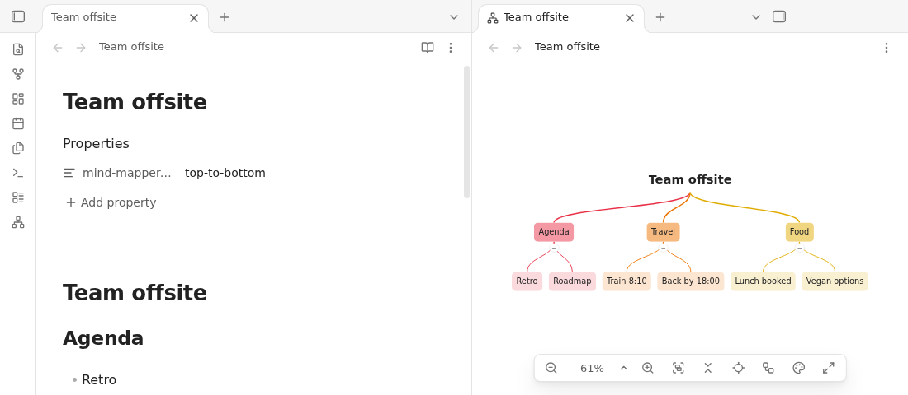

## How a note becomes a map

### Root

| The note has | The root is |
|---|---|
| exactly one H1 and nothing before it | that H1 |
| no H1, several H1s, or content before the first H1 | the file name; all H1s and the content before them hang under it |
| `mind-mapper-title` in its frontmatter | that title, in both cases above |

- Without any H1, the highest heading level in the note forms the first level

### Nodes

| In the note | In the map |
|---|---|
| Heading | a branch; nested by level, a skipped level (H1 then H3) attaches to the nearest heading above |
| Paragraph | one node under its heading |
| List item | one node; nested items nest their nodes; text indented under an item stays in its node |
| Ordered list item | one node, keeps its number |
| Task | one node with its checkbox (read-only) |
| Code block, Mermaid diagram, table, math block | one node, rendered like reading view |
| Quote, callout | one node with everything inside it |
| Image embed `![[image.png]]` | a node with a thumbnail |
| Other embeds (`![[Note]]`, PDF, audio, video) | a plain link, the content is not shown |
| Tag `#solo` | like in reading view with smaller corners; a click opens the tag search |
| Nested tag `#project/alpha/backend` | a two-part pill: the scope `#project/alpha` filled, the value after the last `/` (`backend`) outlined; hover shows the full tag |
| Block ID `^id` | hidden in the node |
| Frontmatter, comments `%% %%`, HTML blocks, footnote definitions | left out |

- Tags in a node take the color of its branch (in every color theme but "none"; the root and the full content overlay keep your theme's tag colors)
- Tags at the end of a line move to the side opposite the text: to the right edge of a left-aligned node, to the left edge of a right-aligned one; centered text keeps them in place, as do tags in the middle of a sentence; in kanban they sit at the right edge of the card

- Large content is clipped at the max node size with a fade; the expand icon in the node's corner shows all of it in an overlay (`Esc` closes it)

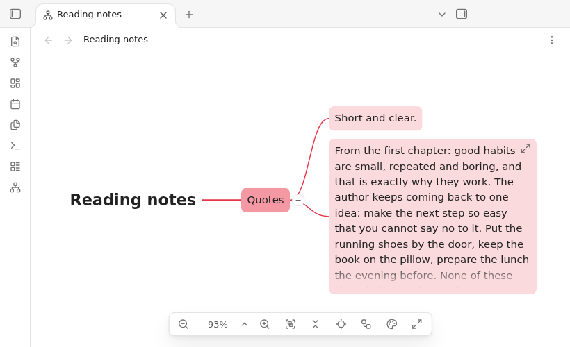

### Dividers

- `---`, `***`, `___` (also `- - -`) are not nodes: they show as a dashed line in a wider gap between the two branches they separate
- The line spans both neighboring branches, down to their deepest visible nodes
- Also shown before a heading, e.g. `***` between two `##` sections
- Not shown: before the first or after the last node of a section, and in the circle layouts exactly at the split between the right and left side; several in a row count as one
- Kanban layout: a vertical line between two columns, a horizontal line between two cards or two subtasks
- Inside a list item, quote or callout a divider is part of that node
- Gotcha: `---` directly under a line of text turns that text into a heading (Markdown rule, same in reading view). Leave a blank line above the divider, or use `***`

```markdown
Day 1: old town.        <- becomes a heading
---

Day 1: old town.        <- stays a paragraph, the divider is a line

---
```

### Links

- Links in nodes work like in Obsidian: click opens, `Ctrl/Cmd` + click opens in a new tab, `Ctrl/Cmd` + hover shows the page preview (like in other plugin views; Obsidian's core plugin "Page preview" in Settings → Core plugins lets you change the modifier)
- Click a tag in a node or in the full content overlay: the search opens with that tag (`tag:#solo`; for a nested tag the full tag, `tag:#project/alpha/backend`, whichever part you click), like in reading view
  - Needs Obsidian's core plugin "Search" (on by default); when it is off, a tag click does nothing
- Links to a heading or block in the same note are also drawn as dashed lines between the two nodes:
  - `[[#Heading]]`, `[[#Heading#Subheading]]`, `[[#^block-id]]`, `[[This note#Heading]]`
  - If one end is inside a collapsed branch, the line ends at the nearest visible node above it
- Click a dashed line to see which two nodes it connects: both nodes get the selection ring and the line gets thicker (still dashed) and is drawn above the nodes; click the empty canvas, a node or another line to end it
  - Only a click on the line highlights a link: selecting a node does not highlight its links
  - Dragging that starts on a line pans the map
- Double click a dashed line to jump to the place in the note where the link is written

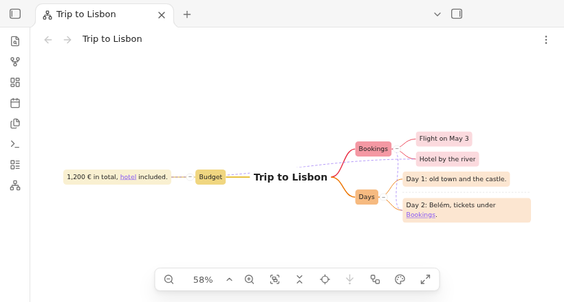

## Move around the map

| Action | How |
|---|---|
| Pan | mouse wheel, two-finger scroll, or drag on the empty canvas |
| Zoom at the pointer | `Ctrl/Cmd` + wheel, or trackpad pinch (10 % to 400 %) |
| Show the whole map | double click the empty canvas (also in full screen), or the Fit to view button; small maps are enlarged up to the setting "Max zoom for fit" (default 150 %); a margin keeps nodes and badges off the edges |

Fit to view, the zoom buttons, the zoom presets, a typed zoom and Back to root glide to their place in about a quarter of a second; the zoom level follows along. Panning and zooming with the wheel or trackpad stay immediate, and a wheel turn or drag during a glide ends it at once. With the system setting "reduce motion" the view jumps instead.

The controls bar at the bottom center, left to right:

| Button | Does |
|---|---|
| Zoom out | zooms out to the next step: 10, 25, 50, 75, 100, 125, 150, 200, 300, 400 % |
| Zoom level (e.g. `60%`) | shows the zoom; click it, type a zoom (e.g. `129`, `87,5 %`) and press `Enter`; `Esc` cancels |
| Chevron next to the zoom level | menu with 50 % to 200 % and Fit to view; the current zoom is checked |
| Zoom in | zooms in to the next step (from 129 %: 150 %) |
| Fit to view (two boxes in a frame) | shows the whole map, enlarging a small one up to "Max zoom for fit" (also done when the map opens, or on a double click on the empty canvas) |
| Collapse all / Expand all | one button: highlighted while anything is collapsed, then a click expands all; otherwise a click collapses all |
| Back to root | centers the root (drilled in: the center node) |
| Drill down (arrow down to a dot) | shows the selected branch as a map of its own, or goes back out one level; see [Drill down](#drill-down) |
| Layout (boxes joined by a line) | menu with the seven layouts for this map only; see [Layout and theme of the open map](#layout-and-theme-of-the-open-map) |
| Color theme (palette) | menu with the color themes for this map only; same section |
| Full screen | see [Full screen](#full-screen) |

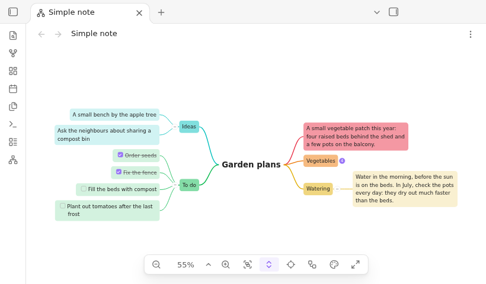

## Select nodes and jump to the note

- Click a node: selects it; click the empty canvas: clears the selection
- Double click a node: jumps to its line in the note
  - In the tab where the note is open (the most recently used one), else in a new split next to the map
  - From full screen, full screen closes first
- Clicking a link or tag inside a node opens the link or the tag search, it does not select the node

## Collapse and expand

- Round button on a node's edge: collapses or expands its branch
  - Collapsed, it shows the number of hidden nodes
  - A collapse that hides the selected node selects the nearest visible node above it
- Collapse all (button or command): only the root and the first level stay visible
- Kanban layout: nodes have no round button; collapse and expand with Collapse all / Expand all. Collapse all leaves the headline and the column headers with their card counts. What you collapsed in another layout stays collapsed
  - The map stays in this mode until Expand all: branches added or moved by later edits start collapsed too
  - Branches you expand by hand stay expanded
- Expand all: shows everything and ends the Collapse all mode
- Start collapsed: open a map like after Collapse all
  - For all notes: setting "Start collapsed"
  - For one note: `mind-mapper-collapsed: true` in its frontmatter (overrides the setting)
  - Changing the value while the map is open collapses or expands all once; other edits keep what you collapsed or expanded
- Collapsed branches are kept while the map is open, not across Obsidian restarts

## Full screen

- Full screen button or command "Toggle full screen": the map covers the whole Obsidian window
- Shows the map, the controls, a title chip on top and an exit button top right
- Controls fade after 2 s without mouse movement; move the mouse to show them
- Exit: `Esc` or the exit button; the previous pan and zoom come back
- Page previews, menus and notices still show on top

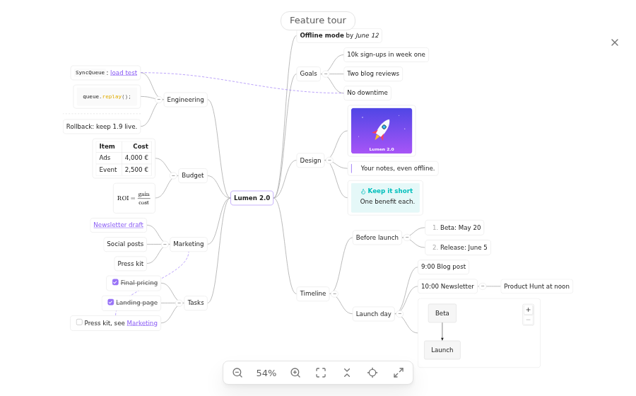

## Drill down

Focus on one branch, e.g. while presenting or exploring a large map: the selected node becomes the center of the map, and only it and everything below it are shown.

- Drill in: select a node with children, then the drill down button in the controls bar (arrow down to a dot), the key `D` or the command "Drill down into selection"
  - The node becomes the center: large and without a box, like the root
  - Its children become the first level: filled boxes, each with its own branch color
  - The map is fitted to view
- `D` works only while the map has focus (it is not a hotkey): typing a "d" in the note or in the zoom level field is not affected
- Drill again inside a drilled view: e.g. Project → Tasks → Phase 2
- Drill out one level: the button or `D` while the center (or nothing) is selected, or the command "Drill out one level"; the command "Show the whole map" goes straight back. The node you drilled out of stays selected, and the map is fitted to view, exactly like "Fit to view"
- While drilled in, the center has a small target icon above it (below it in the bottom → top layout) and the button is highlighted. The button is disabled when there is nothing to drill into or out of
- Link lines to nodes outside the drilled part are hidden
- "Back to root" centers the current center node; collapse, layouts, color themes, full screen and double click to jump work as usual
- Animation: the view glides towards the node, then the map cross-fades into the drilled view; drilling out runs it in reverse. With the system setting "reduce motion" the map switches instantly. Pressing `D` again during the animation finishes it at once and goes on
- The drilled branch belongs to the map tab: it stays after closing and reopening Obsidian and after renaming the note. If the branch is deleted, or its heading renamed, the map quietly shows the whole note again. The note itself is never changed

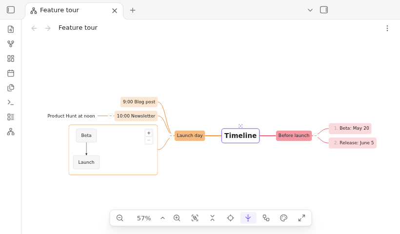

## Layouts

| Layout | Shape |
|---|---|
| `circle-clockwise` (default) | balanced: the first half of the first-level branches on the right (top to bottom), the rest on the left (bottom to top) |
| `circle-counter-clockwise` | the same, mirrored |
| `left-to-right` | all branches grow to the right |
| `right-to-left` | all branches grow to the left |
| `top-to-bottom` | all branches grow downwards |
| `bottom-to-top` | all branches grow upwards |
| `kanban` | a board: the root as headline, the first level as columns, the second as cards, everything deeper as subtasks; see [Kanban](#kanban) |

- For all notes: setting "Default layout"
- For one note: `mind-mapper-layout` in its frontmatter
- For the open map only: the layout button in the controls bar, see [Layout and theme of the open map](#layout-and-theme-of-the-open-map)

`circle-clockwise`:

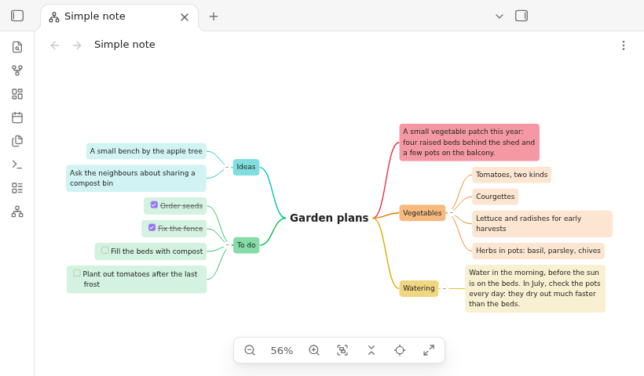

`top-to-bottom`:

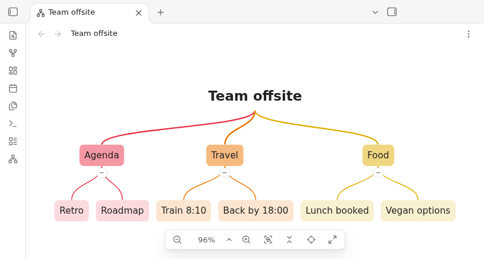

### Kanban

For planning and presenting work: the note as a board with columns and cards, read left to right.

```markdown
---
mind-mapper-layout: kanban
---

# Product launch

## To do

- Write the press release
  - Draft
  - Review with legal
- Book the venue

---

## Doing

- Website redesign
- Beta feedback

## Done

- Name and logo
- Launch date set
```

- The root is the headline, centered above the board
- First-level nodes are the columns, side by side and all the same width (at most "Max node width"; wider content is clipped with a fade)
  - Each column header shows the number of its cards in a small bubble (information only, not a button)
- Second-level nodes are the cards, stacked downwards in their column
- Everything deeper is a subtask: a box below its card, as wide as the card, a little closer to it than the next card, so each task reads as one group
- Colors as usual: column headers filled in their branch color, cards lightly tinted; subtasks get a box that is lighter than their card, and subtasks of subtasks an even lighter one
- No lines between nodes and no collapse buttons on nodes; Collapse all shows only the headline and the column headers (with their counts), Expand all shows everything again
- `---` between two columns draws a vertical line between them; between two cards or two subtasks a horizontal line in the column
- Link lines, selecting, double click to jump, drill down (the node you drill into becomes the headline, its children the columns), color themes and full screen work as in the other layouts

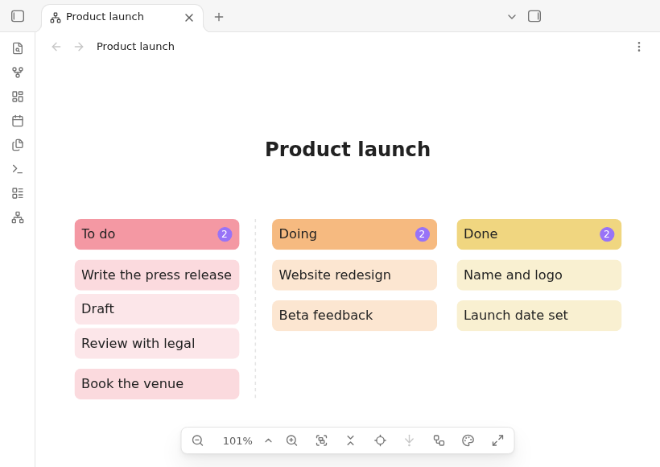

## Color themes

A color theme gives every first-level branch its own color: the first branch gets the first color, the second branch the second, and so on, in the order of the note (also in the circle layouts, whichever side a branch is on). Colors repeat after the last one. Everything below a first-level node takes the color of its branch.

How a node looks depends on its level, in every theme:

- Root: large bold text, no box
- First level: a box filled with the branch color
- Second level: a light tint of the branch color
- Third level and deeper: plain text; the colored line leads into it (kanban: subtasks in lighter boxes, see [Kanban](#kanban))
- Code, tables, callouts, math, diagrams and images: a thin border in the branch color at every level
- Lines: the branch color, slightly thicker into the first level
- Unchanged: the text color, dashed link lines, dividers, the collapse buttons and the selection ring

| Theme | Branch colors |
|---|---|
| `rainbow` (default) | red, orange, yellow, green, cyan, blue, purple |
| `ocean` | blue, cyan, green, purple |
| `forest` | green, yellow, orange, olive |
| `accent` | your accent color (Settings → Appearance) for every branch |
| `none` | the same look in grays |

- For all notes: setting "Default theme"
- For one note: `mind-mapper-theme` in its frontmatter
- For the open map only: the color theme button in the controls bar, see [Layout and theme of the open map](#layout-and-theme-of-the-open-map)
- The colors come from the Obsidian theme: they suit light and dark mode, and community themes can tune them
- Changing the theme applies to an open map right away
- If you chose "None" in an earlier version, the setting stays "None"; pick "Rainbow" to get the colors

`rainbow`:

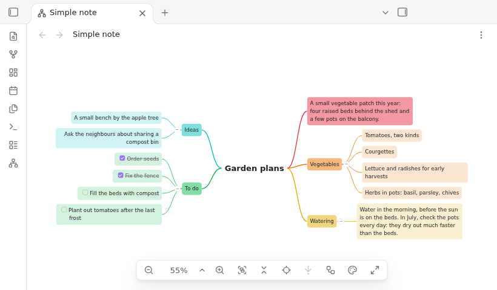

## Layout and theme of the open map

To show a map differently for a moment, e.g. while presenting, change its layout or color theme from the controls bar (also in full screen). This changes only the map on screen; the note and its frontmatter stay as they are.

- Layout button (boxes joined by a line): a menu with balanced clockwise, balanced counter-clockwise, left → right, right → left, top → bottom, bottom → top and kanban; the shown layout is checked. A choice fades the map into the new arrangement (the node in the middle of the view stays put), then glides to fit it to view
- Color theme button (palette): a menu with None, Rainbow, Ocean, Forest and Accent color; the shown theme is checked. A choice recolors the map at once; nothing moves
- Below a line in each menu: "Use the note's layout" / "Use the note's theme" go back to the note's frontmatter, else the settings
- While you have chosen a layout or theme, its button is highlighted. Your choice wins over later edits of `mind-mapper-layout` / `mind-mapper-theme` and over the settings, so the map does not jump while you edit
- The choice belongs to the map tab: it stays after closing and reopening Obsidian and after renaming the note. A map opened anew starts with the note's layout and theme
- Commands: "Change layout…" and "Change color theme…" open the same menus (arrow keys and `Enter` work); "Next layout" and "Next color theme" step to the next one, after the last back to the first

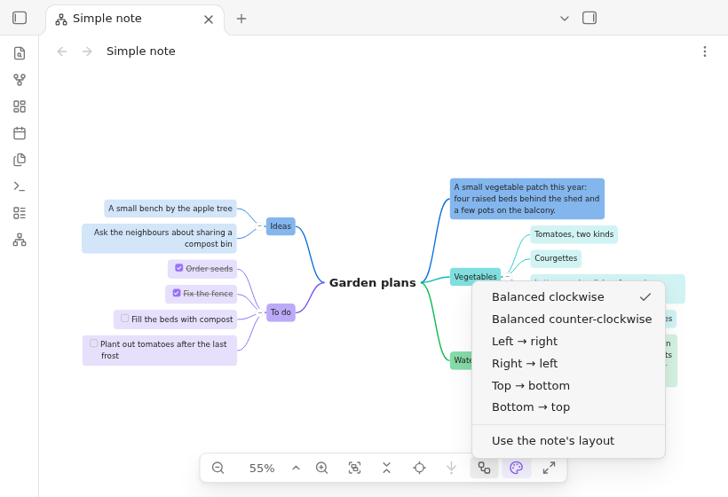

## Frontmatter keys

| Key | Values | Default |
|---|---|---|
| `mind-mapper-title` | any text | the single H1, else the file name |
| `mind-mapper-layout` | one of the [layouts](#layouts) | setting "Default layout" |
| `mind-mapper-collapsed` | `true` or `false` (a checkbox in Properties) | setting "Start collapsed" |
| `mind-mapper-theme` | one of the [color themes](#color-themes) | setting "Default theme" |

```yaml
---
mind-mapper-title: Lumen 2.0
mind-mapper-layout: top-to-bottom
mind-mapper-collapsed: true
mind-mapper-theme: ocean
---
```

- Only the frontmatter at the very top of the note counts
- A missing key or a key without a value uses the default silently
- An invalid value uses the default and shows a notice once per note and value (per session), e.g. `Mind Mapper: unknown mind-mapper-layout "sideways" in Note.md, using circle-clockwise`
  - Invalid: an unknown layout or color theme, a title that is not text (a number, a list), a `mind-mapper-collapsed` that is not `true`/`false` (`yes`, `"true"`, `1`)

## Settings

Settings → Mind Mapper (in the Community plugins part of the sidebar), in four groups. All settings also show up in Obsidian's settings search. Changes apply to open maps right away; "Max zoom for fit" is used the next time a map fits.

| Group | Setting | Control | Range | Default | Does |
|---|---|---|---|---|---|
| Map | Default layout | dropdown | the seven [layouts](#layouts), labelled like in the control bar menu | Balanced clockwise | for notes without `mind-mapper-layout` |
| Map | Start collapsed | toggle | on / off | off | for notes without `mind-mapper-collapsed` |
| Map | Default theme | dropdown | None, Rainbow, Ocean, Forest, Accent color | Rainbow | [color theme](#color-themes) for notes without `mind-mapper-theme` |
| Map | Max zoom for fit | slider, steps of 25 % | 100–400 % | 150 % | how far Fit to view enlarges a small map; large maps shrink to fit |
| Nodes | Max node width | slider, steps of 10 px | 160–800 px | 320 px | wider content is clipped with a fade |
| Nodes | Max node height | slider, steps of 10 px | 120–800 px | 240 px | taller content is clipped with a fade |
| Spacing | Sibling gap | slider, steps of 2 px | 0–200 px | 12 px | space between neighboring branches |
| Spacing | Level gap | slider, steps of 10 px | 20–400 px | 60 px | space between a node and its children |

- Each slider shows its value (e.g. "320 px" or "200 %") and has a "Restore default" button
- About group: the plugin version, a link to the source code and a link to report an issue

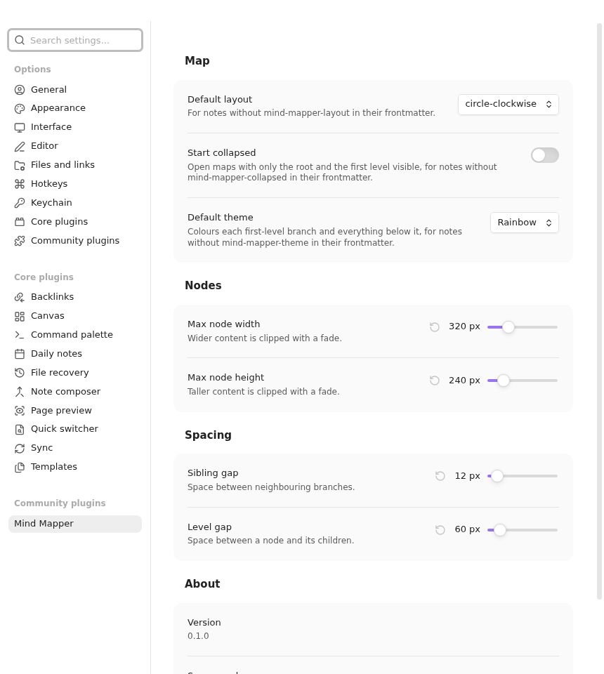

## Commands

Find them in the command palette under "Mind Mapper: …". None has a default hotkey; assign your own in Settings → Hotkeys. Avoid `Ctrl/Cmd + =`, `Ctrl/Cmd + -` and `Ctrl/Cmd + 0`: Obsidian uses them to zoom the whole app.

| Command | Available when | Suggested hotkey |
|---|---|---|
| Open as mind map | a Markdown note is active | |
| Zoom in | a mind map is active | `Ctrl/Cmd + Shift + =` |
| Zoom out | a mind map is active | `Ctrl/Cmd + Shift + -` |
| Fit to view | a mind map is active | `Shift + 1` |
| Reset zoom to 100% | a mind map is active | `Shift + 0` |
| Collapse all | a mind map is active | `Ctrl/Cmd + Shift + [` |
| Expand all | a mind map is active | `Ctrl/Cmd + Shift + ]` |
| Back to root | a mind map is active | `Shift + H` |
| Toggle full screen | a mind map is active | `Ctrl/Cmd + Shift + F11` |
| Change layout… | a mind map is active | |
| Next layout | a mind map is active | `Shift + L` |
| Change color theme… | a mind map is active | |
| Next color theme | a mind map is active | `Shift + T` |
| Drill down into selection | a node with children is selected in the active mind map | |
| Drill out one level | the active mind map is drilled in | |
| Show the whole map | the active mind map is drilled in | |

- Collapse all and Expand all are two commands, so a hotkey always does the same; the controls bar has one button for both
- The key `D` drills in and out without a hotkey, while the map has focus; see [Drill down](#drill-down)

## Languages

- English and German
- Follows Obsidian's language (Settings → General → Language); German when Obsidian is German, else English
- Obsidian applies a language change after a restart
- Frontmatter keys, layout names and color theme names stay English in every language (the settings dropdowns and the control bar menus show translated labels)

## Large notes

- Only nodes in and near the visible area are rendered; more appear as you pan
- Zoomed far out (below 20 %) with more than 60 nodes in view, nodes are drawn as outlines without text; with more than 300 nodes in view always. Zoom in to read
- Lines between nodes and link lines are always complete
- 1,000 nodes open in about 0.1 s and pan and zoom smoothly

## Known limits

- Desktop only
- Read-only: edit the note, not the map; checkboxes in nodes cannot be ticked
- Embedded notes, PDFs and media are links, not shown inline
- Dashed link lines only connect headings and blocks within the same note; they are not routed around nodes
- The map updates when Obsidian saves the note (about 2 s after you stop typing), not on every keystroke
- Collapsed branches are not remembered across restarts
- Renaming the root H1 resets collapse state, selection and drill-down (node IDs start with the root text)
- A second `--- … ---` block in the middle of a note is not frontmatter: its last line becomes a heading
- No export, no search, no editing in the map

## Troubleshooting

| Problem | Cause and fix |
|---|---|
| The map does not show my latest typing | Obsidian saves about 2 s after you stop typing; the map follows then. Pan, zoom, selection and collapsed branches are kept |
| A line of text became a heading | a `---` directly under it (see [Dividers](#dividers)); add a blank line above the `---` or use `***` |
| Notice `Mind Mapper: unknown mind-mapper-layout …` | the layout name is misspelled; use one of the [layouts](#layouts) |
| Notice `Mind Mapper: unknown mind-mapper-theme …` | the theme name is misspelled; use one of the [color themes](#color-themes), in lower case |
| Notice `Mind Mapper: mind-mapper-collapsed … is not true or false …` | use `true` or `false` without quotes, or the checkbox in Properties |
| Notice `Mind Mapper: mind-mapper-title … is not text …` | the title is a number or a list; quote it: `mind-mapper-title: "2026"` |
| Notice `Open a Markdown note first` | the ribbon icon needs an active Markdown note |
| Notice `Mind Mapper: could not open the mind map` | try again; if it repeats, reload Obsidian |
| The map shows "Note was deleted" | the note was deleted; close the map |
| A hotkey does nothing | view commands only act on the active map: click into the map first |
| A node shows only part of its content | it is larger than the max node size: use the expand icon, or raise Max node width / height |
| Text in the map is not readable when zoomed out | large map drawn as outlines: zoom in |
