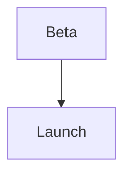

# Launching Lumen 2.0

**Offline mode** by *June 12*

## Goals

- 10k sign-ups in week one
- Two blog reviews
- No downtime ^no-downtime

## Design

![[launch-banner.svg]]

> Your notes, even offline.

> [!tip] Keep it short
> One benefit each.

## Timeline

### Before launch

1. Beta: May 20
2. Release: June 5

### Launch day

- 9:00 Blog post
- 10:00 Newsletter
  - Product Hunt at noon



## Tasks

- [x] Final pricing
- [x] Landing page
- [ ] Press kit, see [[#Marketing]]

## Marketing

- [[Simple note|Newsletter draft]]
- Social posts
- Press kit

## Budget

| Item | Cost |
| --- | ---: |
| Ads | 4,000 € |
| Event | 2,500 € |

$$
\text{ROI} = \frac{\text{gain}}{\text{cost}}
$$

## Engineering

`SyncQueue`: [[#^no-downtime|load test]]

```ts
queue.replay();
```

***

Rollback: keep 1.9 live.
