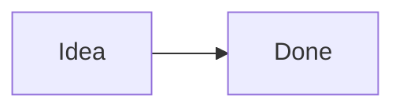

# Rich content

```js
const answer = 42;
```



| Name | Value |
| ---- | ----: |
| α    | 1     |
| β    | 2     |

$$
e^{i\pi} + 1 = 0
$$

> A quote with a list
> - first point
> - second point

> [!note] Callout
> Rendered like in reading view.
