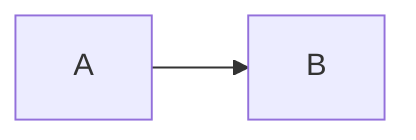

# Blocks

```js
const answer = 42;
```



| Name | Wert |
| ---- | ---- |
| α    | 1    |
| β    | 2    |

$$
e^{i\pi} + 1 = 0
$$

> Quote line
> - list in quote
> - second

> [!note] Callout title
> Callout text
> ```
> code in callout
> ```
